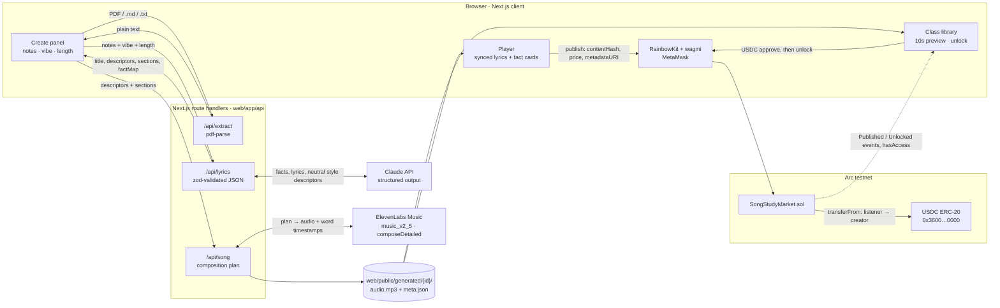

# SongStudy 🎧

**Turn your study notes into songs you can't get out of your head.**
Built solo for the University Blockchain Conference 2026 Hackathon (Austin).

> NotebookLM made your notes into a podcast. SongStudy makes them into a song, and lets your classmates pay you a few cents to study with it.

| | |
|---|---|
| Track | Consumer Applications |
| Chain award | Best use of Arc |
| Bounty | ElevenLabs |
| Run it | Locally in ~2 minutes: see [Run it locally](#run-it-locally) |
| Demo video | TODO: link (shows the full flow end to end) |
| SongStudyMarket (Arc testnet) | [`0x5F7e6da30480Fc92190d17b3F51C7559c9F04A0F`](https://testnet.arcscan.app/address/0x5F7e6da30480Fc92190d17b3F51C7559c9F04A0F) (verified) |

TODO: hero screenshot / GIF of the synced-lyrics player

---

## The problem

Re-reading notes is the least effective way to study, and everyone knows songs stick. You still remember jingles from when you were eight.
But turning a lecture into a song takes musical skill and hours of time. And good study material is trapped in individual notebooks, with no easy way for a student to share it and get paid for it.

## What SongStudy does

1. **Drop in your notes.** Paste text or upload a PDF.
2. **Pick a vibe.** Choose a preset, or say "something like a song I love." SongStudy turns that into a style (genre, tempo, mood, instruments, vocals) without copying the song.
3. **Get a song.** Claude pulls out the key facts and writes accurate, singable lyrics, with the core concept in the chorus. ElevenLabs Music sings it.
4. **Study with synced lyrics.** Karaoke-style lyrics, plus a map showing which fact each line teaches.
5. **Share with your class.** Publish your song for a few cents. Classmates unlock it with USDC that goes straight to you, and the song's fingerprint is recorded onchain as proof you made it.

## Architecture



| Piece | Where |
|---|---|
| Notes → text | `web/app/api/extract/route.ts` (pdf-parse for PDFs) |
| Notes → lyrics, descriptors, fact map | `web/app/api/lyrics/route.ts`, `web/lib/claude.ts` |
| Lyrics → song | `web/app/api/song/route.ts`, `web/lib/elevenlabs.ts` |
| Song storage | `web/lib/storage.ts` → `web/public/generated/{id}/` |
| Synced lyrics | `web/lib/align.ts` (word timestamps → lyric lines) |
| Contract | `contracts/src/SongStudyMarket.sol` (+ 17 Foundry tests) |
| Onchain reads / writes | `web/lib/onchain.ts`, `web/app/components/SharePanel.tsx`, `web/app/components/ClassLibrary.tsx` |

## How we use ElevenLabs

SongStudy uses the **Eleven Music API** (`@elevenlabs/elevenlabs-js`, model **`music_v2_5`**). The song is the product, not an add-on.

1. **We write the composition plan ourselves.** Claude returns the lyrics as sections (Verse 1, Chorus, Verse 2, Bridge, Outro) plus neutral style descriptors. `web/lib/elevenlabs.ts` turns that into a `music_v2_5` composition plan: one chunk per section, with `text` of `[Section]` plus the lyric lines, so ElevenLabs sings our exact words. Each chunk gets a `durationMs`; the song's length (60, 90 or 120 s) is split across sections in proportion to their line counts, and the durations always sum to the target. The first chunk carries the full style list (genre, BPM, key, mood, instruments, vocal style, "clear, intelligible lyrics", "great production quality"). Later chunks keep the core styles plus a section cue such as "big, catchy chorus". All chunks use `contextAdherence: "high"` and negative styles for mumbled vocals and a muddy mix.
2. **`music.composeDetailed({ compositionPlan, modelId: "music_v2_5", withTimestamps: true })`** returns the MP3 and **word-level timestamps** in one call.
3. **Synced karaoke lyrics.** `web/lib/align.ts` matches the timestamped words back to our lyric lines in order, so the player knows when each line starts. The current line is shown large and centered, and the fact card for that line lights up. Our test songs synced 18/18 and 16/16 lines.

### Copyright-safe "sounds like"

Students can type "something like a song I love," but **artist names, song titles and lyrics never reach ElevenLabs**:

- Claude translates the reference into neutral descriptors only (genre and sub-genre, BPM, key and mode, mood, instruments, vocal style). The app shows those descriptors, so the student sees exactly what style was used.
- As a second guard, any descriptor that echoes a distinctive word from the user's reference (an artist's or song's name) is dropped on the server before the plan is built (`scrubReference` in `web/lib/claude.ts`).
- If ElevenLabs still rejects the plan (`bad_prompt` / `bad_composition_plan`), we **retry once with ElevenLabs' own `composition_plan_suggestion`**, and if that fails too, **fall back to the closest preset's style** (chosen by matching genre, instrument and mood words and the nearest BPM). The lyrics stay the same; only the style changes. Each song's `meta.json` records which path was used (`styleSource`).

## How we use Arc

`SongStudyMarket` ([`0x5F7e6da30480Fc92190d17b3F51C7559c9F04A0F`](https://testnet.arcscan.app/address/0x5F7e6da30480Fc92190d17b3F51C7559c9F04A0F), source verified on arcscan) is the onchain half of SongStudy. It's a small contract with no admin keys, no fees and no custody: USDC moves straight from the listener to the creator.

- **USDC is the price and the gas.** Songs cost $0.00–$0.25, and fees on Arc are paid in USDC too, so students only ever think in dollars. Prices use the USDC ERC-20 at `0x3600000000000000000000000000000000000000` with 6 decimals (Arc's native balance shows the same USDC with 18 decimals; the app never mixes the two).
- **Publish = proof of authorship.** "Share with your class" computes `contentHash = keccak256(audio bytes ‖ JSON.stringify({ title, sections, factMap }))` in the browser and calls `publish(contentHash, price, metadataURI)`. The contract stores the creator, price, hash, metadata URI and timestamp, and rejects a hash that was already published, so the first publisher is the recorded author. Anyone with the files can recompute the hash (`web/lib/onchain.ts`).
- **Unlock pays the creator directly.** A classmate approves the exact price in USDC, then calls `unlock(id)`, which does `transferFrom(listener → creator)` and records access. The app shows the steps ("Approving USDC… → Unlocking…") and skips the approval when the allowance already covers it. Free songs skip payment entirely.
- **`hasAccess(id, who)`** decides what the app shows, so an unlocked song stays unlocked after a reload, and the creator always has access.
- **Class library and earnings come from events.** The library lists tracks from `Published` events (viem `getLogs`, read in 9,999-block chunks because Arc's RPC rejects larger ranges). A creator's "Earned $X · N unlocks" adds up `Unlocked` (and `Tipped`) events for their track.
- **Friendly failure states:** wrong network (offers to switch to Arc testnet), not enough USDC for the price or for gas (points to the faucet), and a rejected signature ("Nothing was charged").

**Example transactions (Arc testnet):**

| Step | Transaction |
|---|---|
| Deploy `SongStudyMarket` | [`0xf664d75f…def9cc`](https://testnet.arcscan.app/tx/0xf664d75f6732f7079a1adea495ec0a7e3757a191a177dfa07b94184af8def9cc) |
| Creator publishes *Dual Mandate Flow* (track #0) for $0.05 | [`0x6a5adac8…00af6a`](https://testnet.arcscan.app/tx/0x6a5adac8a262aca6cdd7641da7b4e62f028c507fd20f4f697595deefe500af6a) |
| Classmate approves $0.05 USDC to the market | [`0xbd85b053…60e2c8`](https://testnet.arcscan.app/tx/0xbd85b053f3bb8b0e1401fe03cc3b5b21629d1fbea0026a36f2b922ba9660e2c8) |
| Classmate unlocks track #0: $0.05 USDC goes straight to the creator | [`0xdbd309ac…efc4f4a`](https://testnet.arcscan.app/tx/0xdbd309aca798157b1fe0d0ead08235403c6cac4ff629eb85c7be16cd4efc4f4a) |

## Tech stack

Next.js · TypeScript · Tailwind · shadcn/ui · Claude API · ElevenLabs Music API · Solidity · Foundry · viem · wagmi · RainbowKit · Arc testnet · USDC

## Run it locally

> **The demo video shows the full flow end to end** (notes → song → publish → a classmate unlocking with USDC). These steps let you run the same thing on your machine.

### What you need

- **Node.js 20.9+** and npm
- **MetaMask** (or another browser wallet) in Chrome. The app adds Arc testnet for you when you connect.
- **Testnet USDC** on Arc for gas and unlocks: <https://faucet.circle.com> (choose Arc Testnet). Two accounts (a "creator" and a "classmate") make the demo clearer.
- Optional, only to generate **new** songs: an Anthropic API key and an ElevenLabs API key with Music API access
- Optional, only to run the contract tests: [Foundry](https://book.getfoundry.sh/getting-started/installation)

### Start the app

```bash
git clone --recursive https://github.com/DiegoCarpenter/songstudy.git
cd songstudy
cp .env.example web/.env.local
cd web
npm install
npm run dev
```

Open <http://localhost:3000>.

**Two demo songs ship with the repo** (`web/public/generated/`), so you can play them, see the synced lyrics, and publish/unlock them with no API keys at all.

### Environment variables (`web/.env.local`)

| Variable | Needed for | Value |
|---|---|---|
| `ANTHROPIC_API_KEY` | Generating new songs (lyrics) | Your key from console.anthropic.com |
| `ANTHROPIC_MODEL` | Generating new songs | Prefilled: `claude-sonnet-5-5` |
| `ELEVENLABS_API_KEY` | Generating new songs (music) | Your key; the plan must include Music API access |
| `NEXT_PUBLIC_ARC_RPC_URL` | Onchain features | Prefilled: `https://rpc.testnet.arc.network` |
| `NEXT_PUBLIC_USDC_ADDRESS` | Onchain features | Prefilled: `0x3600000000000000000000000000000000000000` |
| `NEXT_PUBLIC_SONGSTUDY_MARKET_ADDRESS` | Onchain features | Prefilled: our deployed contract |
| `NEXT_PUBLIC_SONGSTUDY_MARKET_DEPLOY_BLOCK` | Class library | Prefilled: `73102727` |
| `NEXT_PUBLIC_WALLETCONNECT_PROJECT_ID` | Optional | Adds mobile/QR wallets; MetaMask works without it |

Everything onchain is prefilled to point at the deployed `SongStudyMarket` on Arc testnet, so you don't need to deploy anything.

### Try the flow

1. **Play a seed song.** In **Your songs**, open *Dual Mandate Flow* and press play. The current lyric line stays centered and bold, and the fact cards below show what each line teaches.
2. **Publish it (creator account).** Click **Connect wallet**, then **Share with your class** → pick a price → **Publish**, and confirm in MetaMask. You get a *Published* badge, a **Receipt** link to arcscan, and an earnings counter.
3. **Unlock it (classmate account).** Switch MetaMask to your second account, open the **Class library** tab, play the 10-second preview, then **Unlock for $0.05**: approve USDC, then unlock. The full song and synced lyrics play, and it stays unlocked after a reload.
4. **See the payment.** Switch back to the creator account; the earnings counter shows the $0.05.
5. **Make your own song** (needs the two API keys). Paste notes or upload a PDF/.md/.txt, pick a vibe (or type "something like <a song you love>"), choose a length, and click **Make my song**. New songs are saved to `web/public/generated/`.

> Note: songs are stored on the machine running the app, so a "classmate" needs to use the same running instance (e.g. two MetaMask accounts in one browser, as above).

### Contracts (optional)

```bash
cd contracts
forge test -vv        # 17 tests, including a fuzz test
```

To deploy your own copy (not needed to run the app):

```bash
cd contracts
printf 'DEPLOYER_PRIVATE_KEY=\nARC_RPC_URL=https://rpc.testnet.arc.network\n' > .env   # add your key; fund it at faucet.circle.com
set -a && source .env && set +a
forge script script/Deploy.s.sol --rpc-url arc_testnet --broadcast
forge verify-contract <ADDRESS> src/SongStudyMarket.sol:SongStudyMarket \
  --chain 5042002 --verifier blockscout --verifier-url https://explorer.testnet.arc.io/api/ \
  --constructor-args $(cast abi-encode 'constructor(address)' 0x3600000000000000000000000000000000000000)
```

Then set `NEXT_PUBLIC_SONGSTUDY_MARKET_ADDRESS` and `NEXT_PUBLIC_SONGSTUDY_MARKET_DEPLOY_BLOCK` in `web/.env.local` to your deployment.

## What's next

- Hosted deployment with cloud storage for songs, so classmates can join from their own devices
- Email-login wallets (Circle user-controlled wallets) so classmates never see a seed phrase
- Quiz mode that turns the fact map into flashcards
- Class spaces: a professor or TA curates the official song pack for an exam
- Revenue splits for co-authored songs

## Acknowledgements

Built during UBC 2026 (Nov 18–20). Uses the ElevenLabs and Anthropic SDKs, RainbowKit/wagmi/viem, and Circle's Arc testnet.
